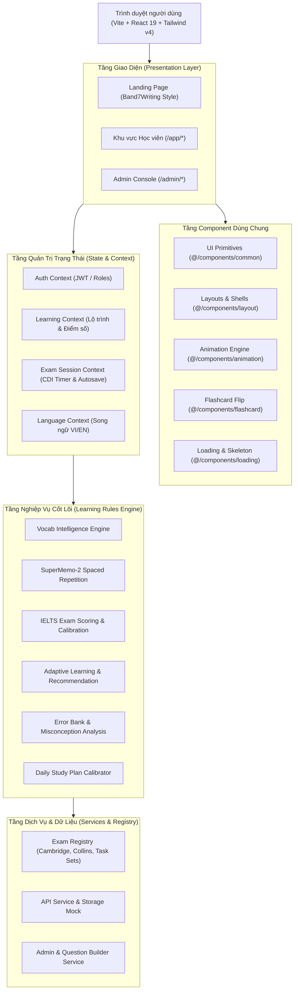

# KIẾN TRÚC TỔNG THỂ HỆ THỐNG IELTS LEARNING PLATFORM
**Enterprise Software Architecture & Engineering Standards**

---

## 1. TỔNG QUAN HỆ THỐNG (SYSTEM OVERVIEW)

IELTS Learning Platform là nền tảng EdTech hiện đại hỗ trợ người học ôn luyện 4 kỹ năng IELTS (Listening, Reading, Writing, Speaking), Từ vựng học thuật Spaced Repetition (SM-2) và Ngữ pháp chuyên sâu. Hệ thống sở hữu giao diện học tập thân thiện theo phong cách Band7Writing, sử dụng hệ nhận diện linh thú Nori và các hiệu ứng chuyển động thương hiệu Google Flow.

---

## 2. PHÂN LỚP KIẾN TRÚC (ARCHITECTURAL LAYERS)

### 2.1. Presentation Layer (`src/pages/`, `src/routes/`)
- Quản lý định tuyến bằng `react-router-dom` v7.
- Phân tách rành mạch giữa:
  * Public Gateway: `/` (Landing Page), `/login`, `/register`, `/forgot-password`, `/onboarding`.
  * Student Workspace: `/app/dashboard`, `/app/learning-path`, `/app/practice/*`, `/app/mock-tests/*`, `/app/ai-tutor`, `/app/statistics`, `/app/profile`.
  * Admin Console: `/admin/dashboard`, `/admin/users`, `/admin/assessments`, `/admin/content/*`, `/admin/learning-plans`, `/admin/security/*`, `/admin/reports`, `/admin/settings`.

### 2.2. Shared Component Architecture (`src/components/`)
Tất cả component được nhóm theo trách nhiệm đơn nhất (Single Responsibility Principle) và có entry point tại `src/components/index.ts`:
- **`@/components/common`**: Các thành phần UI nguyên tử (Atomic Primitives): `Button`, `Card`, `Modal`, `Input`, `Select`, `Textarea`, `Checkbox`, `Radio`, `Tabs`, `ProgressBar`, `Toast`, `EmptyState`.
- **`@/components/layout`**: Khung ứng dụng chính: `AppShell` (Sidebar + Header + Breadcrumb), `LessonWorkspaceLayout`, `TestTakingLayout` (Mô phỏng phòng thi CDI chuẩn quốc tế), `PublicLayout`.
- **`@/components/animation`**: Động cơ quản lý animation linh thú Nori và nhận diện Google Flow (`AnimationRegistry`, `VideoPlayer`, `CelebrationAnimation`, `StatusAnimation`, `LoadingAnimation`, `EmptyStateIllustration`, `FlashcardFlip`, `useAnimationTrigger`).
- **`@/components/flashcard`**: Hệ thống thẻ lật 3D 2 mặt SuperMemo-2 (`Flashcard`, `ReviewProgress`, `ReviewControls`, `SessionSummary`).
- **`@/components/loading`**: Hệ thống khung xương (`Skeleton`, `CardSkeleton`, `PageSkeleton`) và bộ chỉ báo tải trang Nori tung hứng sách.

### 2.3. State & Context Layer (`src/context/`)
Cung cấp dữ liệu phản ứng tức thời (Reactive State) xuyên suốt phiên học:
- **`AuthContext`**: Quản lý phiên đăng nhập, vai trò (`admin`, `learner`, `instructor`), dữ liệu học viên.
- **`LearningContext`**: Đồng bộ tiến độ lộ trình học, điểm kỹ năng, chuỗi ngày streak, lịch ôn Spaced Repetition.
- **`ExamSessionContext`**: Đảm bảo an toàn phòng thi CDI (Timer đếm ngược từng giây, tự động lưu câu trả lời vào LocalStorage/State, chống mất bài khi tải lại trang hoặc rớt mạng).
- **`LanguageContext`**: Hỗ trợ chuyển đổi song ngữ mượt mà Tiếng Việt ⮂ English.

### 2.4. Business Rules & Domain Engine (`src/services/learningRules/`)
Trái tim nghiệp vụ của toàn bộ hệ thống:
1. **Vocabulary Intelligence**: Đề xuất từ vựng trọng tâm Band 7+ theo độ khó CEFR, tần suất xuất hiện và lỗi học viên đã mắc.
2. **Spaced Repetition Engine (SM-2)**: Tính toán chu kỳ giãn cách lặp lại dựa trên đánh giá độ nhớ (1: Again, 2: Hard, 3: Good, 4: Easy), cập nhật Ease Factor và Interval Days.
3. **Scoring Rules**: Quy chuẩn làm tròn điểm thi IELTS quốc tế (làm tròn .25 lên .5, làm tròn .75 lên số nguyên tiếp theo).
4. **Adaptive Engine**: Tự động xác định điểm yếu kỹ năng và điều hướng bài học tiếp theo phù hợp nhất.
5. **Error Bank Service**: Phân loại và phân tích cụm lỗi học viên (Error Clusters: Collocation, Grammatical Range, Task Response...).
6. **Daily Plan Engine**: Tự động cân đối thời lượng học 30–45 phút mỗi ngày với tỷ lệ 60% học mới : 40% ôn tập.

### 2.5. Admin Console Architecture (`src/admin/`)
Console quản trị phân hệ độc lập, tuân thủ nguyên tắc đặc quyền tối thiểu (Least Privilege):
- **Components**: `DataTable`, `DataToolbar`, `FilterPanel`, `StatusBadge`, `DetailHeader`, `DetailSection`, `SideDrawer`, `ConfirmDialog`, `FeedbackOverlay`, `FormField`.
- **Content Drawers**: Hệ thống 6 ngăn kéo nhập liệu nhanh (`CreateVocabularyDrawer`, `CreateGrammarDrawer`, `CreateModuleDrawer`, `CreateLessonDrawer`, `CreateMediaDrawer`, `CreateLearningPlanDrawer`).
- **Question Set Builder**: Module tạo và biên soạn bộ đề IELTS nhiều section, bulk import, kiểm tra passage và audio tự động.
- **Audit Logging**: Mọi hành động nhạy cảm đều được ghi log bất biến (`adminService.recordAuditLog`).
- **Zero Alert Policy**: 100% popup hệ thống dùng modal/overlay chuẩn EdTech, không dùng popup `alert()` mặc định của trình duyệt.

---

## 3. CHUẨN MỰC TÀI NGUYÊN & ANIMATION
- **Tài nguyên tĩnh công khai**: Lưu tại `public/brand/`, `public/stickers/`, `public/visuals/`.
- **Animation gốc**: Lưu tại thư mục `animation/` với 100% định danh file gốc được bảo toàn.
- **Plugin build Vite**: Tự động nạp và sao chép an toàn vào `dist/animation/` trong quá trình build, đảm bảo đường dẫn hoạt động đồng nhất ở cả môi trường dev và production.
- **Bảo vệ trợ năng (Accessibility)**: Hỗ trợ tự động chuyển sang sticker tĩnh khi phát hiện `prefers-reduced-motion`.
