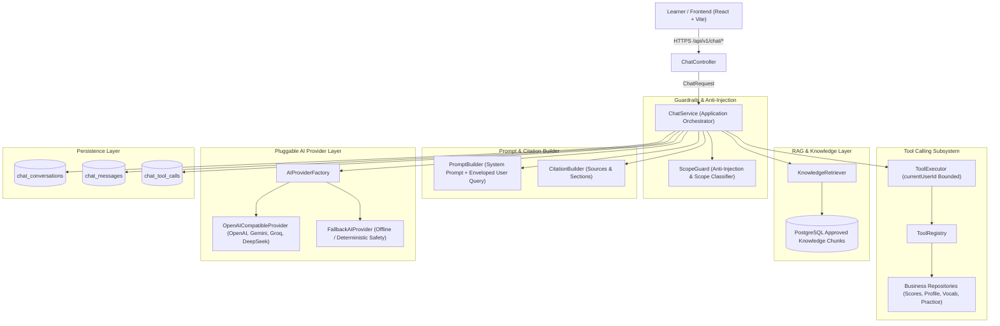

# IELTS Learning Platform - AI Chatbot Architecture

## 1. System Overview

The **IELTS AI Chatbot Subsystem** provides intelligent academic mentoring and automated platform guidance for learners on the IELTS Learning Platform.
It strictly operates within IELTS subject boundaries (Listening, Reading, Writing, Speaking, vocabulary, grammar, and exam strategies) while eliminating hallucinations through real-time tool calling into verified business databases.

---

## 2. Core Architectural Components

### 2.1 Domain & Data Model
- **`chat_conversations`**: Tracks threads, bounded to `user_id`, stores conversation title, active status, message counts, and timestamps.
- **`chat_messages`**: Stores user questions and assistant answers, tokens used, latency in milliseconds, status (`SENT`, `SAFE_ANSWER`, `REFUSED_OUT_OF_SCOPE`, `FLAGGED_SECURITY`), and JSON array of verified citations.
- **`chat_tool_calls`**: Audit trail for all tool executions, logging tool name, sanitized inputs, JSON execution output, execution latency, and success/error status.
- **`knowledge_documents` & `knowledge_chunks`**: Source-of-truth IELTS guides and band descriptors, chunked semantically and tagged with approved status before inclusion in prompts.

### 2.2 Security & Guardrails (`ScopeGuard`)
- **Anti-Prompt Injection**: Strict regex and semantic heuristics neutralize phrases such as `ignore previous instructions`, `system override`, and role-play escalations.
- **Query Classification**: Classifies queries into:
  - `IELTS_KNOWLEDGE`: Academic concepts, band criteria, exam strategies.
  - `PLATFORM_HELP`: How to navigate or use platform features.
  - `PERSONAL_LEARNING_DATA`: Student test history, vocabulary progress.
  - `SUPPORTED_PRACTICE`: Writing/Speaking topic prompts.
  - `OUT_OF_SCOPE`: Out-of-domain topics (cooking, politics, non-IELTS coding).
  - `UNSAFE_OR_UNAUTHORIZED`: Attempts to access system internals or other users' data.
- **Polite Refusal Flow**: Out-of-scope queries receive an immediate polite guidance message redirecting the user back to IELTS skills without burning model inference budget.

### 2.3 Tool Calling Subsystem
- **IDOR Prevention**: Tools **never** receive `userId` from LLM parameters. Instead, `currentUserId` is extracted directly from the verified Spring Security `SecurityContext` principal.
- **Available Tools**:
  1. `getUserStudyProfile`: Learner's target band score, current level, study goals.
  2. `getUserExamResults`: Real test attempts, band scores, breakdown across skills.
  3. `getUserSkillProgress`: Practice session statistics and correct answer ratios.
  4. `getUserVocabulary`: Word bank count, master status, review schedule.
  5. `getUserPracticeHistory`: Recent practice logs.
  6. `searchPlatformLessons`: Official system course curriculum.
  7. `getPlatformGuide`: System features and how-to guides.

### 2.4 RAG Retrieval Layer
- Searches approved chunks from `knowledge_chunks` filtered by skill category (`LISTENING`, `READING`, `WRITING`, `SPEAKING`, `VOCABULARY`, `GRAMMAR`).
- Chunks include verified source attribution (e.g. `Cambridge IELTS Official Guide`, `IELTS Writing Task 2 Descriptors`).
- `CitationBuilder` formats citations as structured metadata attached to the HTTP response, enabling frontend badge rendering.

### 2.5 Pluggable AI Provider Layer
- Implements `AIProvider` interface:
  - `OpenAICompatibleProvider`: Connects to standard OpenAI, DeepSeek, Groq, or Google Gemini OpenAI-compatible endpoints using Java 11 `HttpClient`.
  - `FallbackAIProvider`: Deterministic fallback delivering safe guidance and tool data when no third-party API key is configured.
- Seamlessly configurable via `application.yml` (`chatbot.ai.provider`, `chatbot.ai.model`, `chatbot.ai.api-key`).

---

## 3. Future Roadmap: Machine Learning & Self-Hosted Models
- **Vector Search**: PostgreSQL `pgvector` migration prepared in `AI/data_pipeline/ingest_chunks.py`.
- **Offline Fine-Tuning**: Dedicated benchmark runner in `AI/evaluation/benchmark_eval.py` verifies refusal, tool routing, and citation fidelity against custom open-weights models (e.g., Qwen-2.5-7B, Mistral-7B).
