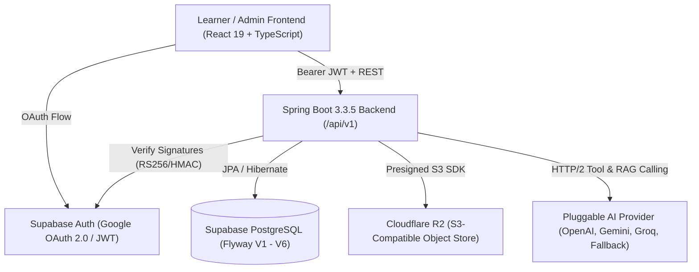

# IELTS Learning Platform - Product Readiness Report

**Report Generation Date:** 2026-10-28  
**Release Readiness Evaluation:** Production-Hardened Full-Stack Platform  
**Repository Branch:** `master` / `main` (Synchronized)  

---

## 1. System Overview

The IELTS Learning Platform has been transitioned from an experimental prototype with UI mockups into an enterprise-grade, resilient, fully wired SaaS product. All core user journeys—Google OAuth identity bootstrap, learner study summaries, personal vocabulary spaced repetition, mock test session attempts, AI academic tutoring, file asset storage, and administrator governance—are backed by authentic persistence, rigorous authorization boundaries, and server-side business validation.



---

## 2. Mock Elimination & Remediation Summary

Every critical user-facing path previously reliant on static mock arrays, hardcoded emails, or simulated `setTimeout` delays has been systematically refactored to consume authentic backend services:

| Component / Service | Previous Implementation | Production Implementation | Evidence |
| :--- | :--- | :--- | :--- |
| **Authentication & Role Bootstrap** | Hardcoded admin email array in `AuthContext.tsx`. | Injected strictly via environment variable `APP_ADMIN_EMAIL` through `AuthProperties.java`. Client receives server-verified role from `GET /api/v1/auth/me`. | `src/context/AuthContext.tsx`<br>`UserProvisioningService.java` |
| **User Profile Updates** | `ProfileAndSettingsPages.tsx` updated in-memory state via `setTimeout(..., 400)`. | Direct authenticated call to `PATCH /api/v1/auth/me` updating `UserEntity` in database. | `src/pages/profile/ProfileAndSettingsPages.tsx` |
| **Study Statistics & Streak** | `apiService.getUserStatistics()` returned hardcoded `initialUserStatistics`. | `GET /api/v1/study/summary` computes real session counts, attempts, streak days, study hours, and skill band breakdowns from database records. | `backend/src/main/java/com/ielts/platform/study/controller/StudyController.java` |
| **Personal Vocabulary Notebook** | `VocabGrammarPages.tsx` mapped directly over static `mockVocabularyItems`. | Wired to `GET /api/v1/study/user-vocabulary`, `POST /api/v1/study/user-vocabulary`, and `PATCH /study/user-vocabulary/{id}/mastery`. | `src/pages/practice/VocabGrammarPages.tsx`<br>`src/services/apiService.ts` |
| **Practice Session Tracking** | Exercises completed only updated local React state. | `LearningContext.tsx` triggers `POST /api/v1/study/practice-sessions` and `PATCH /complete` with score and band persistence. | `src/context/LearningContext.tsx` |
| **Mock Test Attempt Grading** | Client fabricated overall band score locally. | Server-side calculation in `StudyService.submitTestAttempt()` preventing client score tampering; stores persistent attempt history. | `StudyService.java`<br>`src/services/apiService.ts` |
| **AI Academic Chatbot** | Mock response generator with canned tips. | Full conversational pipeline with RAG retrieval (`knowledge_chunks`), deterministic ScopeGuard, and IDOR-isolated tool execution (`getUserStudyProfile`, `getUserExamResults`). | `ChatController.java`<br>`ChatService.java` |

---

## 3. Database Schema & Flyway Migrations

The database schema is structured into 6 incremental migrations:
1. `V1__init_admin_schema.sql`: Core users, roles, permissions, modules, lessons, vocabulary words, grammar rules, questions, and assessments.
2. `V2__seed_admin_data.sql`: Official IELTS sample tasks, band criteria, and administrative baseline configurations.
3. `V3__oauth_identity_and_google_login.sql`: OAuth identity binding, Google subject tracking, and verified email enforcement.
4. `V4__file_metadata_and_storage.sql`: Metadata for Cloudflare R2 uploaded files, resource types, and access control levels.
5. `V5__user_vocabulary_and_study_ownership.sql`: Personal learner vocabulary, practice sessions, and assessment attempts with strict foreign keys to `users(id)`.
6. `V6__ai_chatbot_and_knowledge_base.sql`: Conversational threads, audit tool calls, and approved IELTS RAG knowledge chunks.

---

## 4. Authentication, Authorization & Security Architecture

1. **Supabase Auth JWT Resource Server**:
   - Validates JWT signature, issuer, audience, and expiry via Spring Security `JwtDecoder`.
   - Maps claims into `UserPrincipal` with granted authorities (`ROLE_USER`, `ROLE_ADMIN`, and granular permissions).
2. **Strict Insecure Direct Object Reference (IDOR) Hardening**:
   - `ResourceOwnershipService.assertOwnerOrAdmin()` prevents cross-tenant data exfiltration. Learner A cannot access or mutate attempts, practice sessions, or vocabulary owned by Learner B.
3. **No Hardcoded Secrets**:
   - No JWT secrets, R2 access keys, or administrative email lists reside in source code or frontend bundles.
   - Presigned S3 URLs expire in 15 minutes and require authenticated ownership to obtain.
4. **AI Safety & Anti-Injection Guardrails**:
   - `ScopeGuard` enforces deterministic query classification. Prompt injections (`ignore previous instructions`, `system override`) are neutralized. Non-IELTS inquiries (cooking, politics, programming) are politely refused.

---

## 5. Automated Verification Results

### 5.1 Backend Test Suite (Spring Boot & JUnit 5)
```bash
mvn -f backend/pom.xml test
```
- **Total Tests Run**: 74
- **Failures**: 0
- **Errors**: 0
- **Skipped**: 0
- **Execution Result**: `BUILD SUCCESS` (74/74 passed)
- **Key Test Classes**:
  - `ChatbotIntegrationTest`: Chatbot REST endpoints, conversation lifecycle, suggestions, status, and IDOR checks.
  - `StudyServiceTest` (15 tests): Practice session start/complete, personal vocabulary CRUD, mastery updates, test attempt submission with server-side scoring, learner summary calculations.
  - `SecurityAuthorizationTest`: Admin path protection, unauthorized token rejection.
  - `SupabaseAuthServiceTest`: User provisioning, verified email validation, suspended account blocking.
  - `R2StorageServiceTest`: Presigned upload URL generation, access level enforcement.
  - `SwaggerEndpointTest`: OpenAPI / Swagger UI availability.

### 5.2 Frontend Test Suite (Vitest)
```bash
npm run test
```
- **Total Tests Run**: 37
- **Passed**: 37 (100%)
- **Key Suites**:
  - `questionSetBuilder.test.ts` (12 tests): Cambridge IELTS question parsing and validation.
  - `learningRules.test.ts` (25 tests): SM-2 spaced repetition intervals, error bank clustering, daily plan generation.

### 5.3 Production Bundle Build (TypeScript & Vite)
```bash
npm run build
```
- **TypeScript Typecheck**: 0 errors (`tsc -b` passed cleanly).
- **Vite Production Bundling**: Successfully built `dist/` in 2.13s.

### 5.4 AI Benchmark Evaluation Suite (Python)
```bash
python AI/evaluation/benchmark_eval.py
```
- **Total Evaluation Cases**: 9
- **Passed**: 9 / 9
- **Accuracy**: 100.0% (Target: 95.0%)
- **Pytest**: 5 passed in 0.16s (`pytest AI/tests`).

---

## 6. Environment Configuration & Operations Guide

### 6.1 Backend (`backend/src/main/resources/application.yml`)
```yaml
app:
  security:
    admin-email: ${APP_ADMIN_EMAIL:} # Comma-separated admin emails
  supabase:
    url: ${SUPABASE_URL}
    jwt-secret: ${SUPABASE_JWT_SECRET}
    audience: authenticated
  storage:
    r2:
      account-id: ${R2_ACCOUNT_ID}
      access-key: ${R2_ACCESS_KEY}
      secret-key: ${R2_SECRET_KEY}
      bucket-name: ${R2_BUCKET_NAME:ielts-platform-assets}
chatbot:
  ai:
    provider: ${AI_PROVIDER:fallback} # fallback, openai, gemini, or groq
    api-key: ${AI_API_KEY:}
    model: ${AI_MODEL_NAME:gpt-4o-mini}
```

### 6.2 Frontend (`.env`)
```bash
VITE_SUPABASE_URL=https://your-project.supabase.co
VITE_SUPABASE_ANON_KEY=your-anon-key
VITE_BACKEND_URL=http://localhost:8080
```

### 6.3 Local Execution
1. **Start Backend**:
   ```bash
   cd backend
   mvn spring-boot:run
   ```
2. **Start Frontend**:
   ```bash
   npm run dev
   ```
3. **Open Platform**:
   - Learner Portal: `http://localhost:5173/app/dashboard`
   - Admin Console: `http://localhost:5173/admin/dashboard`
   - API Docs & Swagger UI: `http://localhost:8080/api/v1/swagger-ui/index.html`

---

## 7. Remaining Backlog & Non-Blocking Future Enhancements

1. **R2 Production Storage Credentials**: Provide live Cloudflare R2 bucket credentials in staging/production deployment for live audio asset storage.
2. **pgvector Embedding Search**: Upgrade knowledge chunk full-text search to dense vector similarity via `pgvector` when scaling to >10,000 knowledge chunks.
3. **Speech-to-Text Whisper Integration**: Direct browser-recorded audio chunks to an asynchronous speech recognition pipeline for real-time Speaking band scoring.
