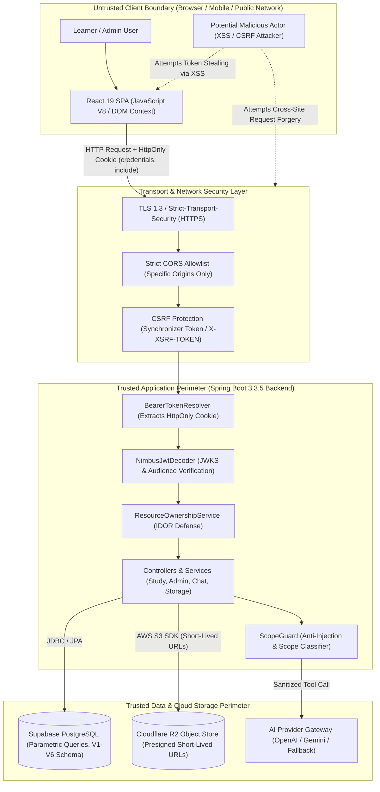

# IELTS Learning Platform - Threat Model & Trust Boundary Specification

**Document Version:** 1.0.0  
**Target Environment:** Production SaaS & Examination Engine  
**Classification:** Application Security Architecture Specification  
**Authors:** Senior Application Security Engineer & DevSecOps Lead  

---

## 1. High-Value Assets to Protect

The IELTS Learning Platform manages assets with high educational, proprietary, financial, and personal value:

| Asset Category | Description & Impact | Confidentiality | Integrity | Availability |
| :--- | :--- | :---: | :---: | :---: |
| **Learner Identity & Credentials** | Supabase Auth UUID, email addresses, OAuth identities, password hashes, session tokens. | **CRITICAL** | **CRITICAL** | **HIGH** |
| **Examination Records & Band Scores** | Official practice test attempts, raw answer submissions, section scores, calculated IELTS overall band scores. | **HIGH** | **CRITICAL** | **HIGH** |
| **Proprietary Content Bank** | Proprietary Cambridge-format questions, reading passages, listening audio recordings, model essays, and scoring rubrics. | **HIGH** | **CRITICAL** | **MEDIUM** |
| **Administrative Access & Controls** | Elevated system role (`ROLE_ADMIN`, `ROLE_SUPER_ADMIN`), user suspension controls, role assignment, audit log inspection. | **CRITICAL** | **CRITICAL** | **CRITICAL** |
| **Personal Learning Notebook** | User-saved vocabulary, SRS mastery levels, practice logs, personal audio recordings for Speaking tasks. | **MEDIUM** | **HIGH** | **HIGH** |
| **Infrastructure Secrets** | Supabase Service-Role Key, R2 S3 Access Keys, AI API keys (OpenAI / Gemini / Groq), JWT verification keys. | **CRITICAL** | **CRITICAL** | **CRITICAL** |
| **AI Inference Quota & Gateway** | Upstream LLM token quotas, RAG chunk retrieval, tool execution pipeline. | **MEDIUM** | **HIGH** | **HIGH** |

---

## 2. Trust Boundaries & Architecture Diagram

---

## 3. Threat Actor Categorization

1. **Unauthenticated Public Scraper / Attacker**:
   - *Goal*: Scrape full IELTS mock test question banks, enumeration of endpoints, brute force auth tokens.
   - *Capability*: Sends crafted HTTP requests, scriptable bots, tampering with headers and cookies.
2. **Malicious Authenticated Learner (Insider Threat / Privilege Escalation)**:
   - *Goal*: Elevate privileges to `ROLE_ADMIN`, tamper with exam band scores, access another student's test results or recordings via Insecure Direct Object Reference (IDOR).
   - *Capability*: Controls valid user JWT / session cookie, manipulates request URLs, parameters, and bodies.
3. **Cross-Site Scripting (XSS) Adversary**:
   - *Goal*: Exploit any client-side DOM reflection or third-party script to exfiltrate user credentials and hijack active sessions.
   - *Mitigation*: **Zero tokens in `localStorage`/`sessionStorage`**; auth cookies configured as `HttpOnly`, `Secure`, `SameSite=Lax`.
4. **Cross-Site Request Forgery (CSRF) Adversary**:
   - *Goal*: Trick an authenticated victim's browser into submitting destructive mutating actions (e.g. submitting incomplete exam attempt, deleting account).
   - *Mitigation*: Double-submit / synchronizer token pattern via `X-XSRF-TOKEN` and Spring Security `CookieCsrfTokenRepository`.
5. **Prompt Injection / LLM Jailbreaker**:
   - *Goal*: Override platform guidance to turn chatbot into general-purpose assistant, extract system prompts, or forge student score summaries.
   - *Mitigation*: Deterministic `ScopeGuard`, input XML envelopes (`<user_query>`), and strict tool argument binding.

---

## 4. Key Security Risks & STRIDE Matrix

| Threat Category (STRIDE) | Attack Vector | Potential Impact | Enforced Platform Countermeasure |
| :--- | :--- | :--- | :--- |
| **Spoofing** | Forging JWT signature or tampering with `sub` claim. | Account takeover, impersonation. | Server verifies RS256/ES256 signatures against Supabase JWKS with explicit audience verification. |
| **Tampering** | Learner alters client-calculated score from 5.5 to 8.5 in submit payload. | Academic fraud, invalid mock certificates. | Server-side grading in `StudyService.submitTestAttempt()`. Client-supplied scores are discarded. |
| **Repudiation** | Administrator denies suspending a user or altering question content. | Loss of accountability, audit compliance failure. | Immutable audit log in `audit_logs` capturing actor ID, client IP, action, and timestamp. |
| **Information Disclosure** | Token exfiltration via XSS or reading `localStorage`. | Persistent account takeover. | **HttpOnly cookies only**. No tokens saved in `localStorage`, `sessionStorage`, or JavaScript variables. |
| **Information Disclosure** | IDOR: Accessing `/api/v1/study/test-attempts/{id}` of another user. | Exfiltration of private test answers and scores. | `ResourceOwnershipService.assertOwnerOrAdmin()` validates resource ownership against SecurityContext. |
| **Denial of Service** | Flooding heavy AI evaluation endpoints or bulk imports. | API exhaustion, high cloud billing. | Rate limiting, request size limits, connection timeouts on third-party SDKs. |
| **Elevation of Privilege** | Client includes `role: "ROLE_ADMIN"` in registration or profile update. | Full administrative takeover. | Role binding strictly controlled by database records and server `APP_ADMIN_EMAIL`. Client input ignored. |

---

## 5. Security Invariants (Non-Negotiable Rules)

1. **Zero Client-Side Token Storage**: Under no circumstances shall an access token, refresh token, or session ID be written to `localStorage`, `sessionStorage`, IndexedDB, or `document.cookie` via JavaScript.
2. **Server-Managed Session Cookies**: Authentication cookies are generated exclusively by Spring Boot via `Set-Cookie` with `HttpOnly`, `Secure` (production), `SameSite=Lax`, and `Path=/`.
3. **Defense-in-Depth for Authorization**: Role checks exist at both HTTP route filters (`hasAnyRole('ADMIN', 'SUPER_ADMIN')`) and method-level annotations (`@PreAuthorize`).
4. **Isolated Tool Calling**: AI tools receive `currentUserId` strictly from verified server security context. LLMs cannot specify or override the target `userId`.
5. **Short-Lived Ephemeral Storage Access**: Cloudflare R2 files require server-minted presigned URLs expiring within 15 minutes. No permanent public buckets for user private data.
